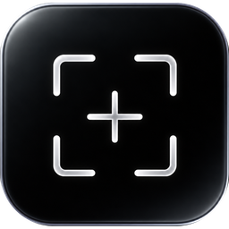

<div align="center">



# Glint

**A fast, local-first screenshot, screen-recording, annotation, and OCR tool for Windows.**

A CleanShot X–style capture suite that keeps everything on your machine — no cloud uploads or accounts.

[](https://github.com/sanirudh17/Glint/releases/latest)
[](LICENSE)
[](#download--install)
[](https://v2.tauri.app/)

</div>

---

## Overview

Glint is an all-in-one screen-capture tool for Windows. Take a screenshot or record your screen, then annotate it, extract its text, pin it above other windows, or drag it straight into another application — all from a quiet corner overlay. Screenshots auto-save to a searchable library, recordings can be trimmed on a multi-cut timeline, and every edit is non-destructive and can be saved as a re-openable project file.

Glint is **local-first by design**. There is no cloud storage, account requirement, telemetry or automatic capture upload. Optional engine downloads and release checks use the network; recognition and editing run locally.

## Table of contents

- [Features](#features)
- [Download & install](#download--install)
- [Building from source](#building-from-source)
- [Tech stack](#tech-stack)
- [Project structure](#project-structure)
- [Privacy](#privacy)
- [License](#license)

## What is new in 0.2.1

- New glass capture icon across the application, Windows shortcuts, installer and tray.
- Ten recent captures in a compact Home layout, with Resume directly below.
- Library metadata is warmed in the background and reused immediately when navigating.
- OCR engine installation and screenshot text search live under Capture settings, with concise model details.
- Bounded background text indexing, thin native WebView2 scrollbars and centered shortcut keycaps.
- More compatible image handoff: PNG, Windows bitmap and a persistent PNG file attachment are copied together, with retry when the clipboard is temporarily busy.

Windows clipboard history has a 4 MB limit per item; direct image copy preserves the full capture. Recognition is local, and OCR accuracy depends on the source image.

## Features

### Screenshots

Capture a **region**, a **window**, or the **full screen**. Selection happens over a frozen snapshot of your desktop, so nothing shifts or animates while you choose what to grab. A magnifier loupe follows the cursor for pixel-precise edges, and a live readout shows the exact dimensions of your selection as you drag.

### Quick Access overlay (HUD)

Every capture drops a compact thumbnail card into the bottom corner of the screen. Cards **stack and accumulate**, so you can capture several things in a row and act on each one independently. Hovering a card reveals its action toolbar:

- **Copy image** to the clipboard, or **copy the file path**
- **Save to Library** (or **Reveal in folder** once saved)
- **Annotate** — opens the capture in the editor
- **Extract text** — runs OCR on the image
- **Pin to screen** — floats it above everything
- **Dismiss** — removes the card

You can also **drag a card directly into any app** that accepts an image or file — Slack, Discord, an email draft, a document — and Glint hands over the real file.

### Annotation editor

A full editor, opened in its own window, with a complete non-destructive toolset:

- **Shapes & lines** — arrow, straight line, rectangle, ellipse
- **Text** with styling
- **Freehand pen** and **highlighter**
- **Blur** for redacting sensitive information
- **Numbered step badges** for walkthroughs
- **Eraser** — a sized, scrubbing eraser for partial freehand cleanup

Every action is fully **undoable/redoable**. The canvas supports scroll-to-zoom centered on the cursor, drag-to-pan, and Fit / 100% controls (`Ctrl` `+` / `-` / `0` / `1`). Export happens at the image's **native resolution** — copy to clipboard, save to a file, or drag out.

### Backgrounds & framing

Turn a raw screenshot into a polished share image. Wrap it in a **solid color, gradient, or transparent** backdrop, then adjust **padding**, **rounded corners**, and a **drop shadow** — all live and WYSIWYG. Non-destructive **crop** with aspect-ratio presets is included, and both the frame and the crop participate in the editor's undo/redo history.

### Capture Text (OCR)

Extract text using **Tesseract**, **PP-OCRv6 Small**, or **PP-OCRv6 Medium**. No OCR runtime or model is bundled. Open Settings > Capture, select an engine and press **Install**. **Remove from disk** deletes Glint's copy; a loaded runtime may finish cleanup after restart. Selecting an engine never starts a download.

### Screen recording

Record a **region** or the **full screen** to an MP4 (H.264, web-optimized with `+faststart`). A 3-2-1 countdown precedes recording, and a floating control bar (record indicator, elapsed timer, pause/resume, stop) drives the session. Stopping is graceful — the file always finishes with a valid `moov` atom, so recordings are never left corrupt.

- **Audio** — capture **system audio** and/or your **microphone**, install-free via WASAPI. Sources are mixed and encoded to AAC, each independently selectable and **live-mutable** mid-recording.
- **Webcam bubble** — an optional circular camera overlay you can drag, resize, and toggle on/off live during the recording.
- **Performance** — high-frame-rate capture (up to 60 fps) with hardware-accelerated encoding.

### Recording trim editor

After recording, open the clip on a **multi-cut timeline**. Split it, delete the parts you don't want, undo mistakes, and step frame-by-frame with gap-skipping preview playback. Export as a **Save copy** (a new `… (trimmed).mp4`) or a rollback-safe **Overwrite** that replaces the original in place.

### Studio video editing

Recordings open directly in Studio with editable cursor data, smoothing, click effects and keystrokes. Add fixed or cursor-following zooms, click-based auto zoom, timed masks and video annotations. Ctrl+Alt+Z during recording adds an editable zoom marker; it does not magnify the live desktop. Draw on screen from the recording pill, then refine those annotations in Studio.

Use shared backgrounds, framing and aspect ratios, webcam layouts, animated gradients, audio cleanup, silence review and optional local English captions. Source recordings stay intact. Combine videos, images and title cards into a saved multi-scene project with transitions. Export MP4 or a bounded GIF (up to 60 seconds and 25 MB).

### Scrolling capture and privacy review

Manual scrolling capture stitches the area you scroll and provides a configurable shortcut. Screenshot privacy review suggests sensitive text for you to inspect and cover. Text search and optional naming use the installed OCR engine locally; small or blurred text and identifiers can be missed. Redactions are applied only when accepted.

### Appearance

Neutral dark and light themes share compact controls, a consistent capture grid and optional desktop acrylic on supported Windows systems. Glass can be switched off in Appearance. Native acrylic uses the current desktop backdrop; solid surfaces are used when Windows does not support or allow transparency.

### Pin to Screen

Float a screenshot as an **always-on-top, borderless window** — perfect for keeping a reference image visible while you work. Drag to move, use the mouse wheel or corner handles to resize (aspect-locked), adjust opacity, and copy or save from a right-click menu.

### Library

Screenshots automatically save to `Pictures\Glint` and are indexed in a local **SQLite** database with thumbnails and a recents list. You can **search**, **rename**, and **delete** entries. Deletion is **two-way synced** with the filesystem: files you remove in Explorer no longer leave orphaned rows, and files you delete in Glint are removed from disk.

### `.glint` project files

Save any edit as a **versioned, self-contained `.glint` document** that embeds the base image alongside its annotations, crop, and frame. Re-open it later to keep editing exactly where you left off, then export a fresh PNG whenever you like. Includes `Ctrl+S`, a dirty-state indicator in the title bar, and a Recent Projects list on the home screen.

### Explorer integration

An **"Open in Glint"** entry appears on any image file (png, jpg, jpeg, webp, bmp, gif) through a per-user shell verb — no administrator rights required. Editing is always non-destructive: the original file on disk is never modified unless you explicitly export over it.

### Interface

A dark, carefully tokenized UI with a **customizable accent color**, a **collapsible navigation sidebar**, and a redesigned neon capture-marquee app icon.

---

## Download & install

Download the latest installer from the [**Releases**](https://github.com/sanirudh17/Glint/releases/latest) page and run it:

| Installer | Notes |
| --- | --- |
| **`Glint_x.y.z_x64-setup.exe`** | NSIS installer — recommended, smaller download. |
| **`Glint_x.y.z_x64_en-US.msi`** | MSI installer — for managed/enterprise deployment. |

The installer includes FFmpeg/FFprobe for recording and export. OCR and caption engines are optional downloads; install only the engines you want. Windows WebView2 is required and the installer can arrange it when needed.

> **Note on Windows SmartScreen.** The installer is not code-signed, so on first run Windows may show a *"Windows protected your PC"* prompt. Click **More info → Run anyway** to proceed. This is expected for unsigned software; code-signing is on the roadmap.

**System requirements:** Windows 10 or 11 (64-bit). WebView2 is preinstalled on Windows 11 and installed automatically by the installer on Windows 10 if it is missing.

---

## Building from source

### Prerequisites

- **[Node.js](https://nodejs.org/)** 24 LTS (or a supported version from package.json), with npm
- **[Rust](https://rustup.rs/)** (stable toolchain)
- The **[Tauri v2 Windows prerequisites](https://v2.tauri.app/start/prerequisites/)** — Microsoft C++ Build Tools and WebView2 (preinstalled on Windows 11)
- **PowerShell** (used by the binary-fetch scripts below)

### 1. Clone and install dependencies

```bash
git clone https://github.com/sanirudh17/Glint.git
cd Glint/glint
npm install
```

### 2. Fetch the bundled binaries

Glint's recorder shells out to FFmpeg/FFprobe. Those binaries are intentionally **not committed**. Fetch them once per build machine, from the repository root:

```powershell
powershell -File scripts/fetch-ffmpeg.ps1
```

This populates `glint/src-tauri/binaries/`, which the app uses at runtime and which `tauri build` bundles into the installer. OCR engines are separate, optional downloads and must not be added to installer resources. The legacy Tesseract staging script is only for maintaining the separately distributed OCR download asset.

### 3. Run in development

```bash
cd glint
npm run tauri dev
```

### 4. Build the installers

```bash
cd glint
npm run tauri build
```

The MSI and NSIS installers are written to `glint/src-tauri/target/release/bundle/`.

### 5. Run the test suite

```bash
cd glint
npm test
```

---

## Tech stack

| Layer | Technology |
| --- | --- |
| Application shell | [Tauri v2](https://v2.tauri.app/) — Rust core + system WebView (WebView2) |
| Frontend | React, TypeScript, Vite, with [Zustand](https://github.com/pmndrs/zustand) state and React Router |
| Annotation canvas | [Konva](https://konvajs.org/) |
| Local database | SQLite (via `sqlx`) |
| Recording & trim | FFmpeg / FFprobe |
| Audio capture | WASAPI (system loopback + microphone) |
| OCR | Tesseract |

## Project structure

```
glint/          The Tauri application
  src/          React + TypeScript frontend
  src-tauri/    Rust core, native commands, and the bundled binaries
docs/           Design documents, per-phase specifications, and the roadmap
scripts/        Binary-fetch helpers (FFmpeg/FFprobe, Tesseract)
```

## Privacy

Glint is **local-first**: there is no cloud sync, account requirement, analytics or automatic capture upload. Optional engine downloads and release checks use the network. Screenshots, recordings, recognition and the library index remain on your machine.

## License

Released under the [MIT License](LICENSE). © 2026 Sanirudh ([sanirudh17](https://github.com/sanirudh17)).

FFmpeg/FFprobe and optional OCR/caption runtimes are third-party software under their respective licenses. Their binaries are not committed to this repository. The separate Tesseract download includes its upstream license and source references.

## Acknowledgements

Built with [Tauri](https://v2.tauri.app/), [FFmpeg](https://ffmpeg.org/), and [Tesseract OCR](https://github.com/tesseract-ocr/tesseract). Inspired by [CleanShot X](https://cleanshot.com/).
